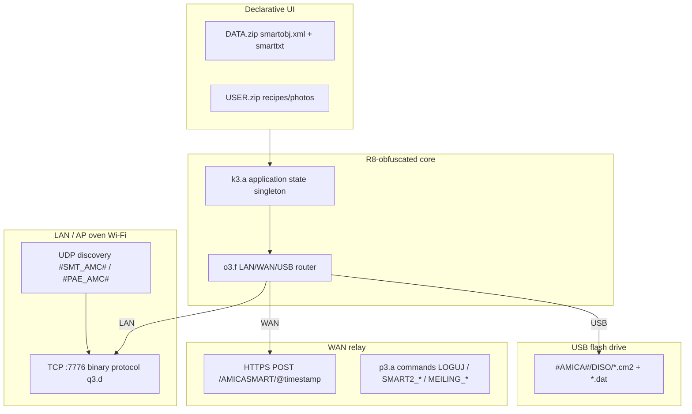

> **Prepared by Jan Konieczny.**

# AmicaIN / SmartIN / SMART2 - findings (full report)

**Package:**`amica.com` ·**Version:**1.0.50 ·**Evidence:** XAPK 2026-10-29, jadx, asset `DATA.zip`.

This document combines communication with the oven (reverse APK) and analysis of the Geryco/MKSoft ecosystem, support and verdict of the custom firmware.

---


**Package:**`amica.com` ·**Badging version:** 1.0.50 (compile/target SDK 36)
**Stack manufacturer:**[MKSoft](https://github.com/search?q=mksoft+smart2) -**SMART2** platform (white-label: Amica, Hansa, SmartIN).
**Entry:**`com.mksoft.smart2.MainActivity` ·**Amica client ID:** `SMARTIN.ANDROID.LAN.` (set in `MainActivity`).

> **Note:**folder `FOTO/FIRMWARE` in assets is**Oven screen wallpapers**, not MCU files. Real OTA/USB described below.

---

## 1. Architecture (layers)



|Layer|Class/file|Role|
|---------|----------------|------|
|Global state| `k3.a` |Devices, Passwords, TCP Thread `q3.e`, Text Map, `u()` = Session ID|
|Network Config| `u3.f` |Ports, HTTP URLs, `comm_mode`, `application_version`|
|Mode router| `o3.f` |`LAN` → socket; `WAN` → `p3.b` + relay; `USB` → save files|
|TCP transfer| `q3.d` |Discovering the oven, status, **upload files (firmware/recipe)** in chunks 992 B|
|UDP broadcast| `q3.a`, `q3.b` |Searching for devices in LAN / configuration|
|JSON WiFi→oven| `n3.c` |SSID/password, fields `M000`, `R001`…, `W001`… (control)|
|HTTP client| `p3.a` |POST to 3 hosts, Base64 payload + `o3.h` cipher|
|USB export| `r3.a` |Catalog `#AMICA#` → `DISO/`|

---

## 2. Connectivity Modes (`comm_mode`)

Enum in `o3.f.b`: **`LAN`**,**`WAN`**,**`USB`** (in UI equivalents AP/LAN/WAN from the Amica Home description - in this older app the nomenclature is in XML `comm_mode`).

|Mode|Behavior (code)|User|
|------|------------------|------------|
|**LAN**|Direct `Socket` to oven IP, port**7776**; refresh by `q3.g`/`q3.f`|Same WiFi as oven (or AP SmartIN)|
|**WAN**|Login `LOGUJ`/`LOGUJ2`, session `CZY_AKTYWNA_SESJA`, commands `MEILING_DEVICE_*` / `SMART2_DEVICE_*` via HTTPS|Remotely via the Amica/MKSoft server|
|**USB**|Saving `.cm2`/`.dat` packages on a `#AMICA#` pendrive or locally in USB mode|Updating/transferring data without TCP|

Default configuration in `u3.f` (overwritten after `GET_TEXT`/`FORMALNE` from the server):

|Parameter|Default value|
|----------|------------------|
| `tcp_port` | **7776** |
| `udp_port` | **7777** |
| `http` | `https://geryco.pl:7770/AMICASMART` |
| `http1` | `https://g4help.com:7770/AMICASMART` |
| `http2` | `https://g4help.pl:7770/AMICASMART` |
|`application_version` (AmicaIN)| **`SMARTIN.ANDROID.LAN.`** |
| `http_timeout` / `tcp_timeout` | 1000 ms |
| `refresh_oven` | 1000 ms |

**HTTP:**`POST {base}/@{yyyyMMddHHmmss}` - body = Base64( XOR/hash pipeline from `o3.h` ).**TLS:**`SSLSocketFactory` with**AllowAllHostnameVerifier** (no pinning - MITM theoretically possible with bad CA).

---

## 3. Device discovery (UDP)

On startup/wizard, the application sends datagrams to **broadcast** (or `udp_ip` from config):

|Magic|Use|
|-------|--------|
| `#SMT_AMC#` |Broadcast "I'm looking for an oven" (`q3.a`)|
| `#PAE_AMC#` / `#PAG_AMC#` |PAE/PAG configuration variant (`q3.b`, type `f9951c` / `f9952d`)|

Payload: Session ID + phone IP (15 characters) + TCP port (6 characters) + counter - then **Byte obfuscation** (`o3.h.d` / `o3.h.g` with seed 123 or 238).

The oven response (TCP cmd `100`, type `2`) includes, among others: bytes **ID / SOFT / HARD / NS** - parsed in `q3.d.d()` as strings of the type `SOFT:xx-yy`, `HARD:…`.

---

## 4. TCP protocol (control + file transfer)

Main logic: **`q3.d.w()`**- sending frames on the hosted**`q3.c`** (`Socket`).

Features (from decompilation):

- Message sequence number (16-bit LE) - must match the response.
- Chunked payload: **max 992 bytes** per frame on upload (`z()`).
- Auxiliary commands: including: **`185`**(ping/init),**`296`**(transfer status),**`300`** (Multiple Choices - transfer).
- Replies decrypted depending on device type (`o3.h.d` seed from `f9962e`).
- Separate thread **`q3.e`** maintains connection, handles timeouts, files `id.bin` / `refridge_id.bin` in the application directory.

### 4.1 Upload to oven (recipes, albums, **firmware**)

Common format (`q3.d.y()` / `r3.a.e()`):

1. Source file → transform **`o3.b.a()`** (compression/obfuscation).
2. Header: **`DZ` + 3 fields + length** + hash `o3.h.c()` based on session ID `k3.a.u()`.
3. XML-like wrapper: **`<cm2>…hash…</cm2><data=…>…</data>`**(WAN uses the**`cm2`** tag in `p3.b.l`).
4. TCP transfer in chunks; UI: **`TransferToOverActivity`**.

**USB:**the same packet saved as `{id}.cm2` (header) + `{id}.dat` (payload) in**`/mnt/.../#AMICA#/DISO/`** (`r3.a`).

**Local USB mode (without pendrive):** `TransferToOverActivity` writes `.cm2` through `k3.a.J().f()` when `comm_mode == USB`.

Support files for recipe transfers: **`com.bin`**,**`tmp`**, extension**`.mtx`**.

---

## 5. Oven firmware - three paths

### A) Update via server (WAN + version list)

1. UI: `DATA/.../UPGRADE/`, `MAIN/AREA/UPGRADE`, service menu (`APP_UPG_*` in `smarttxt.xml`).
2. Version metadata from the server parsed by **`t3.j`**→ list**`u3.g`**: `soft_version`, `server_version`, `hard_version`, `soft_size`,**`is_to_update`**, `is_critical`, `device_id`, `folder`, `data` (Base64).
3. Binary download: via the same HTTPS stack (`p3.a.i` / `h`) - response often **Base64** decoded to local files.
4. After downloading: **TCP upload**(`q3.d.t(u3.h)` iterates and calls `s()`)**or** prepare pendrive.

UX texts (PL): step 1 - put the pendrive in the oven and select update on the panel; step 2 - pendrive back to PC; etc. (`UPGRADE/AREA/STEP*`).

### B) Pendrive (offline)

- Structure: folder **`#AMICA#`**→**`DISO/`**→ pairs**`NNN.cm2`**+**`NNN.dat`**.
- Compatible with `r3.a.g()` export.
- The license text (`ul_pl.txt`) explicitly mentions **updates to the device controller software**.

### C) Update **application itself** AmicaIN (not oven MCU)

- Long press the language tile → **`POBIERZ_LNG`** → `tmp.zip` → unpack structures `DATA` (`LangKafelItm`).
- System **SMART2** in the texts: local backup, rollback, "updating local structures".

Log/UI Thread: **`TCP_UW`**= "Software Update Thread" - refers to the**update process**, not the separate MQTT protocol.

---

## 6. WAN - HTTPS command directory (extracted strings)

|Command|Objective|
|---------|-----|
| `FORMALNE` |Bootstrap: download XML config (`t3.h` → `u3.f`)|
| `GET_TEXT` |UI Texts (`smarttxt`)|
| `LOGUJ` / `LOGUJ2` |WAN registration/login|
| `CZY_AKTYWNA_SESJA` |Session validation|
| `SMART2_POBIERZ_ID` |Device/client ID|
| `SMART2_DEVICE_STATE` / `SMART2_DEVICE_REQUEST` |Status and requests in SMART2 mode|
| `MEILING_DEVICE_STATE` / `MEILING_DEVICE_REQUEST` |Status/requests after binding to `target` (MAC/oven id)|
| `SMART2_POBIERZ_*` |Cookbook, weather, chapters|
| `POBIERZ_LNG` |Language pack/update app|
| `POBIERZ_LISTE_PRZEPISOW` / `POBIERZ_PRZEPIS_CMD` |Recipes|
| `KOMUNIKAT_LISTA_ROZDZIALOW` |`com.bin` for cookbook|

Responses: XML **`VFP`**with `<ret>OK</ret>` or `<ret>ERR</ret>`; network error:**`NETERR`**.

---

## 7. JSON to oven (WiFi provisioning / status)

`n3.c` builds, among others:

```json
{"target":"…","from":"…","type":N, … Wxxx/Rxxx/Mxxx/Exxx fields …}
```

and `{"SSID":"…","password":"…"}` - oven WiFi configuration (`WiFiSettingActivity` collects SSID/password).

Fields **`R001`–`R005`**,**`E000`–`E004`**,**`M000`/`M001`** map oven states (temperatures, heating functions - `n3.d`, `n3.e` generate JSON fragments).

---

## 8. Android Permissions (Implications)

From `badging.txt`:

- `INTERNET`, `ACCESS_WIFI_STATE`, `CHANGE_WIFI_STATE`, `ACCESS_FINE/COARSE_LOCATION` (WiFi scan),
- `LOCAL_MAC_ADDRESS`,
- **`READ/WRITE_EXTERNAL_STORAGE`** (pendrive / files `.cm2`),
- **`DELETE_PACKAGES` / `REQUEST_DELETE_PACKAGES`** (legacy / updater? - requires runtime audit).

No `BLUETOOTH_*` - communication **WiFi + TCP/UDP + HTTPS**, not BLE.

---

## 9. AmicaIN vs Amica Home

| |**AmicaIN**(`amica.com`)|**Amica Home** (`amicahome.com`)|
|--|---------------------------|----------------------------------|
|Generation|SMART2 / SmartIN, MKSoft|Newer product (Play describes AP/LAN/WAN/AUTO)|
|This document| ✅ v1.0.50 |Separate APK analysis|

---

## 10. What still needs runtime verification

- Full TCP command code map (`i7` in `w()`: 100, 185, 296, 300, …).
- Exact file format after `o3.b.a()` before uploading the firmware.
- Relay behavior **geryco / g4help**today (DNS/SSL cert) - hosts may be legacy; app has**3 fallback URL**.
- Passwords in `USER_CONFIG.zip` (zip encrypted - not unzipped).

---

## 11. Quick links in the project

- [COMMUNICATION (this file)](OVEN-COMMUNICATION.md)
- [badging](apk-static/2026-10-29__amicain/badging.txt)
- [endpoints HTTPS](apk-static/2026-10-29__amicain/endpoints.txt)
- [UPGRADE PL hint step 1](assets-extract/2026-10-29/DATA/AMICA/PL/UPGRADE/AREA/STEP1/hint.txt)

**Evidence:** AmicaIN XAPK 2026-10-29, jadx → `com.mksoft.smart2`, `k3`/`q3`/`p3`/`u3`/`r3`, asset `DATA.zip` + `strings classes.dex`.

---

# Part II - SmartIN / SMART2 (Deep)


Supplement [OVEN-COMMUNICATION.md](OVEN-COMMUNICATION.md). Sources: reverse AmicaIN 1.0.50 + public documentation + forums.

---

## 1. Who is behind it (ecosystem map)

|Subject|Role|
|---------|------|
|**Amica S.A.**|Household appliances manufacturer, brand, service, newer**Amica Home**/**Amica Smart** (Tuya)|
|**Geryco sp. z o. o.** (Kraków / historically also UK GERYCO LTD)|"Smart" technical support, portal [geryco.pl/Home/Smart](https://geryco.pl/Home/Smart), HTTPS hosts in apk (`geryco.pl`, `g4help.com/pl`)|
|**MKSoft** (`com.mksoft.smart2` in APK)|**SMART2** platform - application engine, TCP/UDP protocol, `.cm2` format, `AMICASMART` backend|
|**SmartIN**|The oven **Wi-Fi access point name** (SSID) and product line; in the code: `SMARTIN.ANDROID.LAN.*`, packages `amica.com`, `smartin.com`, `com.mksoft.smartin`|
|**White-label**|Same engine: **Hansa**(`HANSA.ANDROID.LAN.`), generic**SMART2.ANDROID.LAN.**|

**Important:** Internet searches for "SMART2" often lead to a **TV dongle or Linux package manager**, not an Amica oven. Search: `mksoft smart2`, `SmartIN`, `geryco`, `AMICASMART`.

---

## 2. Three different "generations" of Amica oven software

Don't get confused - this is **three stacks**:

|Line|Equipment|App|MCU/panel update|
|-------|--------|-----------|---------------------------|
|**Amica .IN + SmartIN WiFi**|RJ45 + WiFi module, display**Tiw**|**AmicaIN**(`amica.com`) - SMART2|MKSoft server → telephone → TCP/USB `#AMICA#`; old PC program**Amica.IN.USB_DataTransfer** (Geryco)|
|**Amica Integra**|LCD, often**SD card** in the programmer|Integra/USB_DataTransfer|**IMG/clone SD**, service pendrive; soft**PGxxx / MGxxx** (Electrode)|
|**Amica .Home / X-Type WiFi**|Knob + WiFi, display**Tc**|**Amica Home**(`amicahome.com`)|**OTA**from the cloud (screen**OtA**), regulations: platform**Tuya IoT**-**different protocol than SMART2**|

AmicaIN **≠** Amica Home. SMART2 reverse engineering does **not** describe Tuya.

**Amica Home** Official Pairing Guide: [Android Tc](https://www.amica.pl/media/wysiwyg/programatory/tc/android_manual.pdf) Pairing PDF.

---

## 3. How to operate it (SmartIN / SMART2) - practice

### 3.1 Oven Side (Geryco + APK)

Source: [Geryco Amica](https://geryco.com.pl/Amica), [geryco.pl Smart](https://geryco.pl/Home/Smart).

1. In the oven WiFi menu: **AP=1**,**M=1**,**S=1** (WiFi enabled, remote control allowed).
2. **WI** mode (communication frame + OK): the **first** app connection registers the **app ID** in the oven "firewall".
3. Home router (LAN/WAN): **2.4 GHz**, WPA2-PSK (TKIP/AES), ports**7770, 7773, 7763**open (TCP; in the apk it dominates locally**7776/7777** - see reverse).
4. AP **SmartIN**: the phone connects directly to the oven AP (like a "remote control").

### 3.2 On the AmicaIN application side (reverse)

|Step|Action|
|------|-----------|
|Installation|`InstallActivity` unpacks `DATA.zip` / `USER.zip` → working directory|
|Bootstrap WAN|`FORMALNE` + `GET_TEXT` → XML config (`t3.h` → ports, URLs)|
|Remote account|`ClientActivity` + `LOGUJ` / `LOGUJ2` (requires previous LAN session according to messages in the apk)|
|Discovery|UDP `#SMT_AMC#` / `#PAE_AMC#` → TCP **7776**|
|Control|JSON `n3.c` (temperatures, functions) + cyclic `q3.d.r()` (~76 B status)|
|Recipes/photos|Transfer `DZ…` + `<cm2>` + chunks **992 B** or USB `#AMICA#/DISO/`|
|Oven firmware|List from server (`t3.j`, `is_to_update`) → HTTPS download → TCP/USB upload (see COMMUNICATION §5)|

### 3.3 Windows (legacy, Geryco)

**Amica.IN.USB_DataTransfer** (Win10+) - recipes, albums, pendrive; does **not** replace full flashing of PG/MG Integra. Description on the Geryco website; users report that**Amica no longer supports** the old file update ecosystem ([Elektroda EB9333BA+ IN, 2024](https://www.elektroda.pl/rtvforum/topic4057250.html)).

### 3.4 New OTA ovens (Amica Home / Tuya)

OTA marketing: over WiFi, message **OtA**, WiFi icon flashing ([Icecat / Amica materials](https://objects.icecat.biz/objects/mmo_120046661_1749168948_653_541992.pdf)).**No reverse engineering of Tuya**: integration via the manufacturer's application, not via the 7770 SMART2 port.

---

## 4. SMART2 protocol - technical abbreviation (for integration)

|Element|Value|
|---------|---------|
|AmicaIN customer ID| `SMARTIN.ANDROID.LAN.{wersja}` |
|TCP device|**7776** (default)|
|UDP| **7777** |
|HTTPS relay|`{geryco\|g4help}:7770/AMICASMART` POST `/@{timestamp}`|
|Payload WAN|Base64 + `o3.h` (XOR-like), no cert pinning|
|Upload|`.cm2` + `.dat`, magic UDP/TCP `#*_AMC#`|
|Oven status|**Not** a full flash dump: SOFT/HARD version and a short status|

Potential integration (Home Assistant etc.): **LAN only**, reverse-engineering `q3.d` and packet capture; **no official API**; WAN requires an MKSoft account and relay.

---

## 5. Custom Firmware/Community - Verdict

### 5.1 SmartIN / SMART2 / AmicaIN (WiFi MKSoft)

|Question|Answer|
|---------|-----------|
|Does anyone publish **custom** firmware for the SmartIN module?|**Not Found** - No repositories, exploits, SMART2 WiFi Oven "root".|
|GitHub `mksoft` / `smart2`|**Unrelated** to Amica (e.g. [mksoft-ltd](https://github.com/mksoft-ltd) - mobile applications; [ubinux/smart2](https://github.com/ubinux/smart2/) - package manager Linux).|
|DIY smart oven|Projects like [SmartOven MQTT](https://github.com/banana-breads/SmartOven) use a **custom oven and ESP32**, not Amica SmartIN.|

**Conclusion:** No community custom firmware for the MKSoft stack was found. Replacing an official `.cm2` package or server response is a theoretical modification, still involving manufacturer software and a high risk of bricking the device.

### 5.2 Amica Integra / IN - soft **PG/MG** (programmer, SD, service pendrive)

This is **another layer**(panel/controller, e.g.**PG351**,**MG351**,**PG353**):

- [Elektroda](https://poszukaj.elektroda.pl/szukaj,amica-piekarnik-oprogramowanie.html): **users share official images**`.IMG` / `.7z` to recover from**SD Card Error**mode**Serwis**, pendrive -**service recoveries**, not "custom ROM".
- Example of sharing a batch: [EBI81064WAA PG351.05](https://www.elektroda.pl/rtvforum/topic4066841.html) (file from a forum member).
- **EB9333BA+ IN**: USB instructions exist, but **Amica no longer provides the software** or supports the update program ([topic4057250](https://www.elektroda.pl/rtvforum/topic4057250.html)).

No homebrew **custom firmware** was found, only factory images, clones, and service recovery material. Flashing an unmatched PG/MG image risks damaging the device.

### 5.3 Amica Smart / Home (Tuya)

Terms and conditions: application for **Tuya IoT**([PDF agreement](https://amica-group.de/media/wysiwyg/AmicaSmart/PL_-_Amica_Smart_-_Regulamin_oraz_umowa_u_ytkownika_-_final.pdf)). Custom = Tuya ecosystem (other devices), **not** a documented Amica OTA hack. **Factory OTA** comes from Tuya/Amica servers.

---

## 6. Application firewall on the oven

Geryco states that the first connection in **WI** mode adds the **application identifier** to the oven whitelist. In the APK, session **`k3.a.u()`** (id.bin), the hash in `LOGUJ`, and `MEILING_*` fields with MAC/target indicate that **the phone is not a generic TCP client** without prior registration or known session secrets.

Implication: a **custom LAN script** must reproduce discovery and the handshake, or use an ID from a legitimately paired phone, only for the operator's **own** device.

---

## 7. Open directions (legal, own equipment)

1. **Capture LAN** (tcpdump on the router) during: discovery, heating on, firmware update - `q3.d.w(…, i7, …)` opcode mapping.
2. Comparison of **Amica Home**APK (Tuya) vs**AmicaIN** - do the new models use SMART2 at all.
3. Finding the current URL **Amica.IN.USB_DataTransfer** on Geryco (links often without a direct href in HTML - just a description).
4. **Home Assistant**: wrapper only after stable LAN status reading (without WAN login emulation).

---

## 8. External links (reading order)

1. [Geryco - Smart / Amica IN](https://geryco.pl/Home/Smart) - Ports, WI, M/S/AP, USB_DataTransfer
2. [Geryco Amica (PL)](https://geryco.com.pl/Amica)
3. [Amica Home - Pairing PDF](https://www.amica.pl/media/wysiwyg/programatory/tc/android_manual.pdf)
4. [Elektroda - Amica soft oven (index)](https://poszukaj.elektroda.pl/szukaj,amica-piekarnik-oprogramowanie.html)
5. [Elektroda - not supported EB9333BA+ IN](https://www.elektroda.pl/rtvforum/topic4057250.html)
6. [Amica Smart - Tuya Agreement PDF](https://amica-group.de/media/wysiwyg/AmicaSmart/PL_-_Amica_Smart_-_Regulamin_oraz_umowa_u_ytkownika_-_final.pdf)

---

*Evidence: AmicaIN APK 2026-10-29, public web 2026-10-29. No confirmed SmartIN custom firmware in public sources.*
