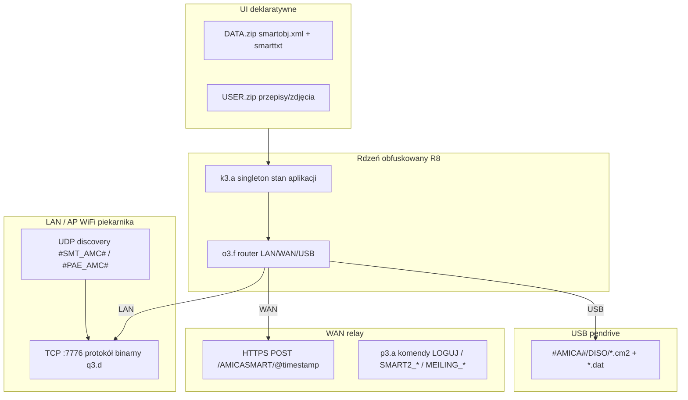

> **Przygotowane przez Jan Koneiczny.**

# AmicaIN — komunikacja z piekarnikiem, firmware, protokoły

**Pakiet:** `amica.com` · **Wersja badging:** 1.0.50 (compile/target SDK 36)  
**Producent stacku:** [MKSoft](https://github.com/search?q=mksoft+smart2) — platforma **SMART2** (white-label: Amica, Hansa, SmartIN).  
**Entry:** `com.mksoft.smart2.MainActivity` · **Identyfikator klienta Amica:** `SMARTIN.ANDROID.LAN.` (ustawiany w `MainActivity`).

> **Uwaga:** folder `FOTO/FIRMWARE` w assetach to **tapety ekranu piekarnika**, nie pliki MCU. Prawdziwe OTA/USB opisane poniżej.

---

## 1. Architektura (warstwy)



| Warstwa | Klasa / plik | Rola |
|---------|----------------|------|
| Stan globalny | `k3.a` | Urządzenia, hasła, wątek TCP `q3.e`, mapa tekstów, `u()` = ID sesji |
| Konfig sieci | `u3.f` | Porty, URL-e HTTP, `comm_mode`, `application_version` |
| Router trybu | `o3.f` | `LAN` → socket; `WAN` → `p3.b` + relay; `USB` → zapis plików |
| TCP transfer | `q3.d` | Odkrywanie piekarnika, stan, **upload plików (firmware/recipe)** w chunkach 992 B |
| UDP broadcast | `q3.a`, `q3.b` | Szukanie urządzeń w LAN / konfiguracja |
| JSON WiFi→oven | `n3.c` | SSID/hasło, pola `M000`, `R001`…, `W001`… (sterowanie) |
| HTTP klient | `p3.a` | POST na 3 hosty, payload Base64 + szyfr `o3.h` |
| USB export | `r3.a` | Katalog `#AMICA#` → `DISO/` |

---

## 2. Tryby łączności (`comm_mode`)

Enum w `o3.f.b`: **`LAN`**, **`WAN`**, **`USB`** (w UI odpowiednikom AP/LAN/WAN z opisu Amica Home — w tej apce starszej nazewnictwo jest w XML `comm_mode`).

| Tryb | Zachowanie (kod) | Użytkownik |
|------|------------------|------------|
| **LAN** | Bezpośredni `Socket` na IP piekarnika, port **7776**; odświeżanie przez `q3.g`/`q3.f` | Ten sam WiFi co piekarnik (lub AP SmartIN) |
| **WAN** | Logowanie `LOGUJ`/`LOGUJ2`, sesja `CZY_AKTYWNA_SESJA`, komendy `MEILING_DEVICE_*` / `SMART2_DEVICE_*` przez HTTPS | Zdalnie przez serwer Amica/MKSoft |
| **USB** | Zapis pakietów `.cm2`/`.dat` na pendrive `#AMICA#` lub lokalnie w trybie USB | Aktualizacja / przenoszenie danych bez TCP |

Domyślna konfiguracja w `u3.f` (nadpisywana po `GET_TEXT`/`FORMALNE` z serwera):

| Parametr | Wartość domyślna |
|----------|------------------|
| `tcp_port` | **7776** |
| `udp_port` | **7777** |
| `http` | `https://geryco.pl:7770/AMICASMART` |
| `http1` | `https://g4help.com:7770/AMICASMART` |
| `http2` | `https://g4help.pl:7770/AMICASMART` |
| `application_version` (AmicaIN) | **`SMARTIN.ANDROID.LAN.`** |
| `http_timeout` / `tcp_timeout` | 1000 ms |
| `refresh_oven` | 1000 ms |

**HTTP:** `POST {base}/@{yyyyMMddHHmmss}` — body = Base64( XOR/hash pipeline z `o3.h` ). **TLS:** `SSLSocketFactory` z **AllowAllHostnameVerifier** (brak pinningu — MITM teoretycznie możliwy przy złym CA).

---

## 3. Odkrywanie urządzenia (UDP)

Na starcie / wizardzie aplikacja wysyła datagramy na **broadcast** (lub `udp_ip` z config):

| Magic | Użycie |
|-------|--------|
| `#SMT_AMC#` | Broadcast „szukam piekarnika” (`q3.a`) |
| `#PAE_AMC#` / `#PAG_AMC#` | Wariant konfiguracji PAE/PAG (`q3.b`, typ `f9951c` / `f9952d`) |

Payload: ID sesji + IP telefonu (15 znaków) + port TCP (6 znaków) + licznik — potem **obfuskacja bajtowa** (`o3.h.d` / `o3.h.g` z seed 123 lub 238).

Odpowiedź piekarnika (TCP cmd `100`, typ `2`) zawiera m.in. bajty **ID / SOFT / HARD / NS** — parsowane w `q3.d.d()` jako stringi typu `SOFT:xx-yy`, `HARD:…`.

---

## 4. Protokół TCP (sterowanie + transfer plików)

Główna logika: **`q3.d.w()`** — wysyłka ramek na utrzymywanym **`q3.c`** (`Socket`).

Cechy (z decompilacji):

- Numer sekwencyjny komunikatu (16-bit LE) — musi zgadzać się z odpowiedzią.
- Payload chunkowany: **max 992 bajty** na ramkę przy uploadzie (`z()`).
- Komendy pomocnicze: m.in. **`185`** (ping/init), **`296`** (status transferu), **`300`** (Multiple Choices — transfer).
- Odpowiedzi deszyfrowane zależnie od typu urządzenia (`o3.h.d` seed z `f9962e`).
- Osobny wątek **`q3.e`** utrzymuje połączenie, obsługuje timeouty, pliki `id.bin` / `refridge_id.bin` w katalogu aplikacji.

### 4.1 Upload do piekarnika (przepisy, albumy, **firmware**)

Wspólny format (`q3.d.y()` / `r3.a.e()`):

1. Plik źródłowy → transform **`o3.b.a()`** (kompresja/obfuskacja).
2. Nagłówek: **`DZ` + 3 pola + długość** + hash `o3.h.c()` na bazie ID sesji `k3.a.u()`.
3. Opakowanie XML-like: **`<cm2>…hash…</cm2><data=…>…</data>`** (WAN używa tagu **`cm2`** w `p3.b.l`).
4. Transfer TCP w chunkach; UI: **`TransferToOverActivity`**.

**USB:** ten sam pakiet zapisywany jako `{id}.cm2` (nagłówek) + `{id}.dat` (payload) w **`/mnt/.../#AMICA#/DISO/`** (`r3.a`).

**Lokalny USB mode (bez pendrive):** `TransferToOverActivity` zapisuje `.cm2` przez `k3.a.J().f()` gdy `comm_mode == USB`.

Pliki pomocnicze w transferach przepisów: **`com.bin`**, **`tmp`**, rozszerzenie **`.mtx`**.

---

## 5. Firmware piekarnika — trzy ścieżki

### A) Aktualizacja przez serwer (WAN + lista wersji)

1. UI: `DATA/.../UPGRADE/`, `MAIN/AREA/UPGRADE`, menu serwisowe (`APP_UPG_*` w `smarttxt.xml`).
2. Metadane wersji z serwera parsowane przez **`t3.j`** → lista **`u3.g`**: `soft_version`, `server_version`, `hard_version`, `soft_size`, **`is_to_update`**, `is_critical`, `device_id`, `folder`, `data` (Base64).
3. Pobranie binariów: przez ten sam stos HTTPS (`p3.a.i` / `h`) — odpowiedź często **Base64** dekodowana do plików lokalnych.
4. Po pobraniu: **TCP upload** (`q3.d.t(u3.h)` iteruje i woła `s()`) **lub** przygotowanie pendrive.

Teksty UX (PL): krok 1 — włóż pendrive do piekarnika i wybierz aktualizację na panelu; krok 2 — pendrive z powrotem w PC; itd. (`UPGRADE/AREA/STEP*`).

### B) Pendrive (offline)

- Struktura: folder **`#AMICA#`** → **`DISO/`** → pary **`NNN.cm2`** + **`NNN.dat`**.
- Zgodne z eksportem `r3.a.g()`.
- Pieczęć licencyjna (`ul_pl.txt`) explicite wymienia **aktualizację oprogramowania programatora urządzenia**.

### C) Aktualizacja **samej aplikacji** AmicaIN (nie MCU piekarnika)

- Długie naciśnięcie kafelka języka → **`POBIERZ_LNG`** → `tmp.zip` → rozpakowanie struktur `DATA` (`LangKafelItm`).
- System **SMART2** w tekstach: backup lokalny, rollback, „aktualizacja struktur lokalnych”.

Wątek w logach/UI: **`TCP_UW`** = „Wątek aktualizacji oprogramowania” — dotyczy **procesu update’u**, nie osobnego protokołu MQTT.

---

## 6. WAN — katalog komend HTTPS (wyekstrahowane stringi)

| Komenda | Cel |
|---------|-----|
| `FORMALNE` | Bootstrap: pobranie XML config (`t3.h` → `u3.f`) |
| `GET_TEXT` | Teksty UI (`smarttxt`) |
| `LOGUJ` / `LOGUJ2` | Rejestracja / logowanie WAN |
| `CZY_AKTYWNA_SESJA` | Walidacja sesji |
| `SMART2_POBIERZ_ID` | ID urządzenia / klienta |
| `SMART2_DEVICE_STATE` / `SMART2_DEVICE_REQUEST` | Stan i żądania w trybie SMART2 |
| `MEILING_DEVICE_STATE` / `MEILING_DEVICE_REQUEST` | Stan/żądania po powiązaniu z `target` (MAC/id piekarnika) |
| `SMART2_POBIERZ_*` | Książka kucharska, pogoda, rozdziały |
| `POBIERZ_LNG` | Paczka językowa / update app |
| `POBIERZ_LISTE_PRZEPISOW` / `POBIERZ_PRZEPIS_CMD` | Przepisy |
| `KOMUNIKAT_LISTA_ROZDZIALOW` | `com.bin` dla cookbook |

Odpowiedzi: XML **`VFP`** z `<ret>OK</ret>` lub `<ret>ERR</ret>`; błąd sieci: **`NETERR`**.

---

## 7. JSON do piekarnika (WiFi provisioning / status)

`n3.c` buduje m.in.:

```json
{"target":"…","from":"…","type":N, … pola Wxxx/Rxxx/Mxxx/Exxx …}
```

oraz `{"SSID":"…","password":"…"}` — konfiguracja WiFi piekarnika (`WiFiSettingActivity` zbiera SSID/hasło).

Pola **`R001`–`R005`**, **`E000`–`E004`**, **`M000`/`M001`** mapują stany piekarnika (temperatury, funkcje grzania — `n3.d`, `n3.e` generują fragmenty JSON).

---

## 8. Uprawnienia Android (implikacje)

Z `badging.txt`:

- `INTERNET`, `ACCESS_WIFI_STATE`, `CHANGE_WIFI_STATE`, `ACCESS_FINE/COARSE_LOCATION` (skan WiFi),
- `LOCAL_MAC_ADDRESS`,
- **`READ/WRITE_EXTERNAL_STORAGE`** (pendrive / pliki `.cm2`),
- **`DELETE_PACKAGES` / `REQUEST_DELETE_PACKAGES`** (legacy / updater? — wymaga audytu runtime).

**Brak** `BLUETOOTH_*` — komunikacja **WiFi + TCP/UDP + HTTPS**, nie BLE.

---

## 9. AmicaIN vs Amica Home

| | **AmicaIN** (`amica.com`) | **Amica Home** (`amicahome.com`) |
|--|---------------------------|----------------------------------|
| Generacja | SMART2 / SmartIN, MKSoft | Nowszy produkt (Play opisuje AP/LAN/WAN/AUTO) |
| Ten dokument | ✅ v1.0.50 | Osobna analiza APK |

---

## 10. Co jeszcze wymaga runtime (nie ze statyki)

- Pełna mapa kodów poleceń TCP (`i7` w `w()`: 100, 185, 296, 300, …).
- Dokładny format pliku po `o3.b.a()` przed wgraniem firmware.
- Zachowanie relay **geryco / g4help** dziś (DNS/SSL cert) — hosty mogą być legacy; app ma **3 fallback URL**.
- Hasła w `USER_CONFIG.zip` (zip encrypted — nie rozpakowany).

---

## 11. Szybkie linki w projekcie

- [KOMUNIKACJA (ten plik)](KOMUNIKACJA-PIEKARNIK.md)
- [badging](apk-static/2026-10-29__amicain/badging.txt)
- [endpointy HTTPS](apk-static/2026-10-29__amicain/endpoints.txt)
- [UPGRADE PL hint krok 1](assets-extract/2026-10-29/DATA/AMICA/PL/UPGRADE/AREA/STEP1/hint.txt)

**Evidence:** AmicaIN XAPK 2026-10-29, jadx → `com.mksoft.smart2`, `k3`/`q3`/`p3`/`u3`/`r3`, asset `DATA.zip` + `strings classes.dex`.
