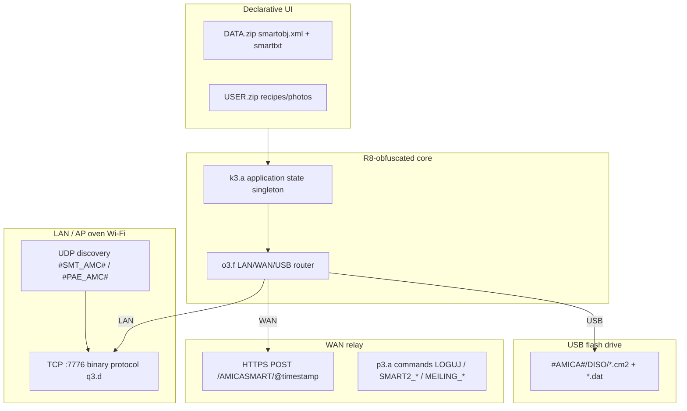

> **Prepared by Jan Konieczny.**

# AmicaIN - communication with the oven, firmware, protocols

**Package:**`amica.com` ·**Badging version:** 1.0.50 (compile/target SDK 36)
**Stack manufacturer:**[MKSoft](https://github.com/search?q=mksoft+smart2) -**SMART2** platform (white-label: Amica, Hansa, SmartIN).
**Entry:**`com.mksoft.smart2.MainActivity` ·**Amica client ID:** `SMARTIN.ANDROID.LAN.` (set in `MainActivity`).

> **Note:**folder `FOTO/FIRMWARE` in assets is**Oven screen wallpapers**, not MCU files. Real OTA/USB described below.

---

## 1. Architecture (layers)



|Layer|Class/file|Role|
|---------|----------------|------|
|Global state| `k3.a` |Devices, Passwords, TCP Thread `q3.e`, Text Map, `u()` = Session ID|
|Network Config| `u3.f` |Ports, HTTP URLs, `comm_mode`, `application_version`|
|Mode router| `o3.f` |`LAN` → socket; `WAN` → `p3.b` + relay; `USB` → save files|
|TCP transfer| `q3.d` |Discovering the oven, status, **upload files (firmware/recipe)** in chunks 992 B|
|UDP broadcast| `q3.a`, `q3.b` |Searching for devices in LAN / configuration|
|JSON WiFi→oven| `n3.c` |SSID/password, fields `M000`, `R001`…, `W001`… (control)|
|HTTP client| `p3.a` |POST to 3 hosts, Base64 payload + `o3.h` cipher|
|USB export| `r3.a` |Catalog `#AMICA#` → `DISO/`|

---

## 2. Connectivity Modes (`comm_mode`)

Enum in `o3.f.b`: **`LAN`**,**`WAN`**,**`USB`** (in UI equivalents AP/LAN/WAN from the Amica Home description - in this older app the nomenclature is in XML `comm_mode`).

|Mode|Behavior (code)|User|
|------|------------------|------------|
|**LAN**|Direct `Socket` to oven IP, port**7776**; refresh by `q3.g`/`q3.f`|Same WiFi as oven (or AP SmartIN)|
|**WAN**|Login `LOGUJ`/`LOGUJ2`, session `CZY_AKTYWNA_SESJA`, commands `MEILING_DEVICE_*` / `SMART2_DEVICE_*` via HTTPS|Remotely via the Amica/MKSoft server|
|**USB**|Saving `.cm2`/`.dat` packages on a `#AMICA#` pendrive or locally in USB mode|Updating/transferring data without TCP|

Default configuration in `u3.f` (overwritten after `GET_TEXT`/`FORMALNE` from the server):

|Parameter|Default value|
|----------|------------------|
| `tcp_port` | **7776** |
| `udp_port` | **7777** |
| `http` | `https://geryco.pl:7770/AMICASMART` |
| `http1` | `https://g4help.com:7770/AMICASMART` |
| `http2` | `https://g4help.pl:7770/AMICASMART` |
|`application_version` (AmicaIN)| **`SMARTIN.ANDROID.LAN.`** |
| `http_timeout` / `tcp_timeout` | 1000 ms |
| `refresh_oven` | 1000 ms |

**HTTP:**`POST {base}/@{yyyyMMddHHmmss}` - body = Base64( XOR/hash pipeline from `o3.h` ).**TLS:**`SSLSocketFactory` with**AllowAllHostnameVerifier** (no pinning - MITM theoretically possible with bad CA).

---

## 3. Device discovery (UDP)

On startup/wizard, the application sends datagrams to **broadcast** (or `udp_ip` from config):

|Magic|Use|
|-------|--------|
| `#SMT_AMC#` |Broadcast "I'm looking for an oven" (`q3.a`)|
| `#PAE_AMC#` / `#PAG_AMC#` |PAE/PAG configuration variant (`q3.b`, type `f9951c` / `f9952d`)|

Payload: Session ID + phone IP (15 characters) + TCP port (6 characters) + counter - then **Byte obfuscation** (`o3.h.d` / `o3.h.g` with seed 123 or 238).

The oven response (TCP cmd `100`, type `2`) includes, among others: bytes **ID / SOFT / HARD / NS** - parsed in `q3.d.d()` as strings of the type `SOFT:xx-yy`, `HARD:…`.

---

## 4. TCP protocol (control + file transfer)

Main logic: **`q3.d.w()`**- sending frames on the hosted**`q3.c`** (`Socket`).

Features (from decompilation):

- Message sequence number (16-bit LE) - must match the response.
- Chunked payload: **max 992 bytes** per frame on upload (`z()`).
- Auxiliary commands: including: **`185`**(ping/init),**`296`**(transfer status),**`300`** (Multiple Choices - transfer).
- Replies decrypted depending on device type (`o3.h.d` seed from `f9962e`).
- Separate thread **`q3.e`** maintains connection, handles timeouts, files `id.bin` / `refridge_id.bin` in the application directory.

### 4.1 Upload to oven (recipes, albums, **firmware**)

Common format (`q3.d.y()` / `r3.a.e()`):

1. Source file → transform **`o3.b.a()`** (compression/obfuscation).
2. Header: **`DZ` + 3 fields + length** + hash `o3.h.c()` based on session ID `k3.a.u()`.
3. XML-like wrapper: **`<cm2>…hash…</cm2><data=…>…</data>`**(WAN uses the**`cm2`** tag in `p3.b.l`).
4. TCP transfer in chunks; UI: **`TransferToOverActivity`**.

**USB:**the same packet saved as `{id}.cm2` (header) + `{id}.dat` (payload) in**`/mnt/.../#AMICA#/DISO/`** (`r3.a`).

**Local USB mode (without pendrive):** `TransferToOverActivity` writes `.cm2` through `k3.a.J().f()` when `comm_mode == USB`.

Support files for recipe transfers: **`com.bin`**,**`tmp`**, extension**`.mtx`**.

---

## 5. Oven firmware - three paths

### A) Update via server (WAN + version list)

1. UI: `DATA/.../UPGRADE/`, `MAIN/AREA/UPGRADE`, service menu (`APP_UPG_*` in `smarttxt.xml`).
2. Version metadata from the server parsed by **`t3.j`**→ list**`u3.g`**: `soft_version`, `server_version`, `hard_version`, `soft_size`,**`is_to_update`**, `is_critical`, `device_id`, `folder`, `data` (Base64).
3. Binary download: via the same HTTPS stack (`p3.a.i` / `h`) - response often **Base64** decoded to local files.
4. After downloading: **TCP upload**(`q3.d.t(u3.h)` iterates and calls `s()`)**or** prepare pendrive.

UX texts (PL): step 1 - put the pendrive in the oven and select update on the panel; step 2 - pendrive back to PC; etc. (`UPGRADE/AREA/STEP*`).

### B) Pendrive (offline)

- Structure: folder **`#AMICA#`**→**`DISO/`**→ pairs**`NNN.cm2`**+**`NNN.dat`**.
- Compatible with `r3.a.g()` export.
- The license text (`ul_pl.txt`) explicitly mentions **updates to the device controller software**.

### C) Update **application itself** AmicaIN (not oven MCU)

- Long press the language tile → **`POBIERZ_LNG`** → `tmp.zip` → unpack structures `DATA` (`LangKafelItm`).
- System **SMART2** in the texts: local backup, rollback, "updating local structures".

Log/UI Thread: **`TCP_UW`**= "Software Update Thread" - refers to the**update process**, not the separate MQTT protocol.

---

## 6. WAN - HTTPS command directory (extracted strings)

|Command|Objective|
|---------|-----|
| `FORMALNE` |Bootstrap: download XML config (`t3.h` → `u3.f`)|
| `GET_TEXT` |UI Texts (`smarttxt`)|
| `LOGUJ` / `LOGUJ2` |WAN registration/login|
| `CZY_AKTYWNA_SESJA` |Session validation|
| `SMART2_POBIERZ_ID` |Device/client ID|
| `SMART2_DEVICE_STATE` / `SMART2_DEVICE_REQUEST` |Status and requests in SMART2 mode|
| `MEILING_DEVICE_STATE` / `MEILING_DEVICE_REQUEST` |Status/requests after binding to `target` (MAC/oven id)|
| `SMART2_POBIERZ_*` |Cookbook, weather, chapters|
| `POBIERZ_LNG` |Language pack/update app|
| `POBIERZ_LISTE_PRZEPISOW` / `POBIERZ_PRZEPIS_CMD` |Recipes|
| `KOMUNIKAT_LISTA_ROZDZIALOW` |`com.bin` for cookbook|

Responses: XML **`VFP`**with `<ret>OK</ret>` or `<ret>ERR</ret>`; network error:**`NETERR`**.

---

## 7. JSON to oven (WiFi provisioning / status)

`n3.c` builds, among others:

```json
{"target":"…","from":"…","type":N, … Wxxx/Rxxx/Mxxx/Exxx fields …}
```

and `{"SSID":"…","password":"…"}` - oven WiFi configuration (`WiFiSettingActivity` collects SSID/password).

Fields **`R001`–`R005`**,**`E000`–`E004`**,**`M000`/`M001`** map oven states (temperatures, heating functions - `n3.d`, `n3.e` generate JSON fragments).

---

## 8. Android Permissions (Implications)

From `badging.txt`:

- `INTERNET`, `ACCESS_WIFI_STATE`, `CHANGE_WIFI_STATE`, `ACCESS_FINE/COARSE_LOCATION` (WiFi scan),
- `LOCAL_MAC_ADDRESS`,
- **`READ/WRITE_EXTERNAL_STORAGE`** (pendrive / files `.cm2`),
- **`DELETE_PACKAGES` / `REQUEST_DELETE_PACKAGES`** (legacy / updater? - requires runtime audit).

No `BLUETOOTH_*` - communication **WiFi + TCP/UDP + HTTPS**, not BLE.

---

## 9. AmicaIN vs Amica Home

| |**AmicaIN**(`amica.com`)|**Amica Home** (`amicahome.com`)|
|--|---------------------------|----------------------------------|
|Generation|SMART2 / SmartIN, MKSoft|Newer product (Play describes AP/LAN/WAN/AUTO)|
|This document| ✅ v1.0.50 |Separate APK analysis|

---

## 10. What still needs runtime verification

- Full TCP command code map (`i7` in `w()`: 100, 185, 296, 300, …).
- Exact file format after `o3.b.a()` before uploading the firmware.
- Relay behavior **geryco / g4help**today (DNS/SSL cert) - hosts may be legacy; app has**3 fallback URL**.
- Passwords in `USER_CONFIG.zip` (zip encrypted - not unzipped).

---

## 11. Quick links in the project

- [COMMUNICATION (this file)](OVEN-COMMUNICATION.md)
- [badging](apk-static/2026-10-29__amicain/badging.txt)
- [endpoints HTTPS](apk-static/2026-10-29__amicain/endpoints.txt)
- [UPGRADE PL hint step 1](assets-extract/2026-10-29/DATA/AMICA/PL/UPGRADE/AREA/STEP1/hint.txt)

**Evidence:** AmicaIN XAPK 2026-10-29, jadx → `com.mksoft.smart2`, `k3`/`q3`/`p3`/`u3`/`r3`, asset `DATA.zip` + `strings classes.dex`.
